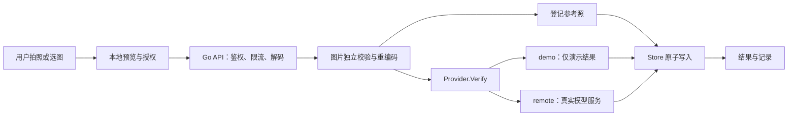

# 架构与后端设计

## 项目结构

```text
web/src/                   # 页面状态、采集流程、响应式样式
backend/cmd/server/        # 配置、监听、关闭与依赖组装
backend/internal/app/
  http.go                  # 路由、鉴权、请求限制和响应契约
  image.go                 # 图片校验与元数据去除
  provider.go              # 演示/远程模型接口
  store.go                 # 本地数据与原子提交
  lock_*.go                # 同一目录跨进程互斥
  app_test.go              # 服务端行为与并发验证
tests/                     # 真实 Go 服务上的浏览器流程测试
Demo/                      # 旧工程，仅参考，不由新服务提供
```

采用标准库 HTTP 服务，不引入 Web 框架或数据库驱动。新页面与 API 同源，减少跨域配置和多服务部署成本。前端没有隐式轮询上传或识别成功的随机数。

## 请求链路



## API 层

请求体最多 5MiB，单张原始/重编码图片最多 3MiB。先读取图片尺寸再完整解码，限制像素数。每个进程最多同时处理两个登记/核验请求，超过返回 429 与 Retry-After；慢模型请求有 15 秒超时，HTTP Server 另有请求头、读写和空闲超时。

全局 middleware 设置 CSP、no-store、nosniff、Referrer-Policy 与 Permissions-Policy。拒绝跨源和跨站请求；无令牌的本地模式只接受回环 Host，减少 DNS rebinding 风险。API Bearer token 用恒定时间比较。令牌不进入 URL 或日志。

这里的并发槽位不是按用户的速率限制，也不替代生产网关。所有持有同一令牌的操作者共享全部人员与记录，没有角色隔离。

## 模型层

Provider 将 HTTP/API 逻辑和模型执行分离。DemoProvider 返回 decision=demo 且无 score，任何图片都只演示流程。RemoteProvider 使用服务器配置的固定 endpoint，不接受前端传入任意地址，不跟随重定向，不暴露模型服务错误原文。

远程响应必须提供 matched、score、face_count 与 liveness。仅当单人脸、活体 passed、matched=true 且 score 达到配置阈值时返回 matched；多脸、无人脸、活体不确定或失败返回 review。分数不等同于概率，不应显示为“识别准确率”。

仓库没有实现模型训练、向量提取、活体算法或校准。静态照片不足以证明真实现场活体；接入模型若需要视频挑战，应设计独立挑战/会话协议，不能让静态接口自行声称已完成安全活体认证。登记阶段只校验图片结构，不检测人脸；真实服务还必须验证参考图有效性。

## 存储层

状态结构为 version + subjects + records。人员包含 id、name、created_at、参考照；对外列表使用 DTO，不返回参考照。记录包含人员 id、名称快照、时间、模式、决定、可选分数及描述，不包含临时照片。

Store 使用读写锁。写操作复制下一份状态，先写同目录 0600 临时文件并 Sync，再 Rename，成功后替换内存状态。若磁盘写入失败，内存仍为旧状态。删除人员时同一次提交删除参考照与关联记录；核验过程中人员若已被删除，AddRecord 会重新检查，阻止孤立记录写入。

`.lock` 由系统文件锁保证同一数据目录只有一个服务进程；进程退出后自动释放，不在运行中删除锁文件。多副本部署应迁移到带事务的数据库和对象存储，不能共享当前 JSON 目录。

JSON 在规模上是 O(n) 全量重写，适合 Demo 的 50 人/200 条记录上限，不适合大型图库。当前原子替换避免半写入，但不等于具备事务日志或断电后的最高持久化保证。

## 前端状态与失败处理

主状态包括服务模式、人员集合、记录集合、当前照片、页面和请求状态。提交期间禁用关键控件，避免普通双击重复请求。网络请求不自动重试；超时提示先查看记录再重试，因为客户端超时并不意味着服务端一定没有完成写入。

摄像头只在用户操作时开启，使用 generation 防止已取消请求返回后重新占用设备。切页、后台、页面退出都会停止媒体轨道。图像在浏览器等比例缩放，前后镜头只镜像预览，不镜像提交图像。

未来生产化应添加请求幂等键、按用户鉴权、审计事件、加密与保留策略、数据库迁移、备份恢复、模型监控和针对目标人群/环境的校准与评估。
